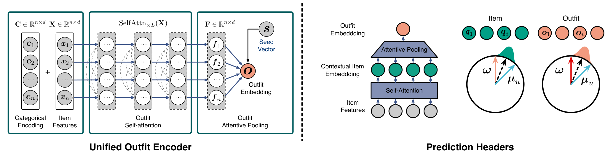

<div align="center">

<h1>👗 Unified Metric Learning</h1>
<p><b>for Personalized Fashion Recommendations with Fast User Adaptation</b></p>
<p>Zhi Lu · Yang Hu · Cong Yu · Yan Chen · Bing Zeng</p>

[](https://www.eezhilu.com/resources/papers/tmm-2026-unified.pdf)
[](https://huggingface.co/datasets/lzcn/outfit-datasets)
[](LICENSE)

</div>

PyTorch implementation of our **IEEE TMM 2026** paper. UML embeds items, outfits, and users in a shared metric space and adapts to new users from a few positive outfits.

## ✨ Method



*Framework from Fig. 2 of the TMM paper.*

- **Outfit encoding:** category embeddings, self-attention, and attentive pooling produce a compact outfit representation.
- **Personalization:** global and user anchors model shared compatibility and individual preferences.
- **New users:** estimate user anchors from positive support outfits while keeping the encoder fixed.

## 🚀 Get started

Use Python 3.11 with PyTorch and torchvision.

```bash
python -m pip install -r requirements.txt
hf download lzcn/outfit-datasets --repo-type dataset \
  --revision 69614542ed4e696bb39fa1e029afe4e9ce134cd8 \
  --local-dir data --exclude "*/features/images/*"
```

The Hugging Face dataset includes processed outfit splits and pre-extracted ResNet-34 features. Three pretrained **Model-r** checkpoints are included in [`weights/`](weights/):

| Dataset | Checkpoint | New-user split |
| --- | --- | --- |
| Polyvore-U519 (`polyvore-519`) | [model-r-polyvore-519.pt](weights/model-r-polyvore-519.pt) | `polyvore-32` |
| Polyvore-U630 (`polyvore-630`) | [model-r-polyvore-630.pt](weights/model-r-polyvore-630.pt) | `polyvore-53` |
| IQON-550 (`iqon-550`) | [model-r-iqon-550.pt](weights/model-r-iqon-550.pt) | `iqon-58` |

## 📊 Evaluate

```bash
python main.py +experiment=compatibility data=polyvore-519 \
  task.stage=test task.load_pretrained=weights/model-r-polyvore-519.pt
```

AUC and NDCG are averaged over users. Compatibility and four-choice FITB each use 10 trials. For the other datasets, change `data` and the checkpoint to the matching entry above.

## 🆕 New users

```bash
python main.py +experiment=new_user data=polyvore-32 \
  task.source_num_users=519 \
  task.load_pretrained=weights/model-r-polyvore-519.pt
```

This evaluates 1, 5, and 10 positive support outfits over 50 trials. With one support outfit, inference uses all source user anchors with positive similarity; with 5 or 10, it uses the normalized mean support embedding. See [`new_user.py`](tasks/evaluators/new_user.py).

For `polyvore-53` or `iqon-58`, use `task.source_num_users=630` or `550` and the corresponding checkpoint.

## 🏋️ Train

```bash
python main.py +experiment=compatibility data=polyvore-519
```

Hydra saves logs, configuration, and checkpoints in the run directory. Use `task.device=cuda:0` to select a GPU or `task.device=cpu data.num_workers=0` for CPU.

## 📚 Citation

If you use this code or build on our work, please cite both papers:

```bibtex
@article{Lu_2026_TMM,
  title = {Unified Metric Learning for Personalized Fashion Recommendations with Fast User Adaptation},
  author = {Lu, Zhi and Hu, Yang and Yu, Cong and Chen, Yan and Zeng, Bing},
  journal = {IEEE Transactions on Multimedia},
  year = {2026},
  pages = {1--14},
  doi = {10.1109/TMM.2026.3694502}
}

@inproceedings{Lu_2021_CVPR,
  title = {Personalized Outfit Recommendation With Learnable Anchors},
  author = {Lu, Zhi and Hu, Yang and Chen, Yan and Zeng, Bing},
  booktitle = {Proceedings of the IEEE/CVF Conference on Computer Vision and Pattern Recognition (CVPR)},
  month = {June},
  year = {2021},
  pages = {12722--12731}
}
```

MIT license.
